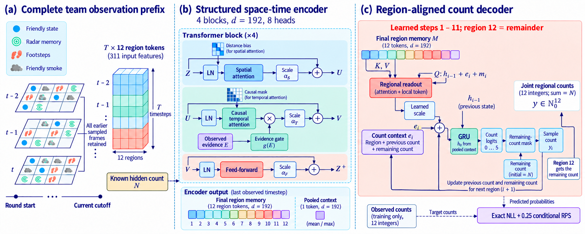

# RAST

**Region-Aligned Spatiotemporal Transformer for anonymous opponent occupancy in Counter-Strike 2.**

**RAST** is the executed `improved_transformer` implementation and its saved checkpoints. **CS2-AOC** is the frozen 53-match processed benchmark supplied here. The repository preserves the trained implementation and its recorded results.

This repository-ready package contains the final region-aligned model, a task-specific processed dataset, fixed match splits, trained checkpoints, saved predictions, and reproducible mechanism plots for a Counter-Strike 2 study. The final method is `improved_transformer`: a structured full-history encoder, remaining-population-conditioned regional readout, and a population-conserving autoregressive count decoder. Its training objective is exact joint count NLL plus 0.25 conditional ranked probability score (RPS).



**Public-release status:** prepared locally for a subsequent GitHub upload by the authors. No public repository URL or DOI has been assigned. This repository contains code, processed data, saved results, figures, and documentation. The actual manuscript, LaTeX sources, bibliography, and supplementary paper are kept in the separate author workspace.

## Quick start

Use Python 3.10--3.12. A working NVIDIA CUDA environment is recommended for full training. To reproduce the retained three-method experiment:

```bash
python main.py
```

The entry point reuses a working CUDA Python environment or creates its own `.venv_run` for dependencies. The included prepared data are used directly; training does not need the original 25.82 GB of DEMOs and does not download them. Run the following to check the included data without training:

```bash
python main.py --prepare-only --offline
python tools/verify_dataset.py
```

The default methods are KNN, ordinary Transformer, and the final region-aligned model, each evaluated with seeds 2026, 2027, and 2028. Every Transformer uses width 192, four blocks, eight heads, effective batch 128, and measured memory-aware micro-batches. The maximum is 40 epochs with validation-ES early stopping, patience 8. The complete observation prefix is retained; no early-history cropping or cross-round stitching occurs. Epoch progress bars show the epoch's peak allocated GPU memory.

The source release omits unused development model definitions. The model construction, initialization order, parameter names, and forward computations of the two retained neural methods match their original trained implementation; see `compatibility_check.json`. Results and portable logs are written under `outputs/cs2_final_model_reproduction/`.

## Dataset construction: verified work and provenance

We curated **53 unique professional-event Dust2 DEMOs, totaling 25,818,929,645 bytes (25.818930 decimal GB; 24.045752 GiB)**. The recordings cover March 23--April 20, 2026 and 31 original event labels. They include IEM Rio 2026 (six Dust2 maps), PGL Bucharest 2026 (two), BetBoom Storm Season 2, and multiple ESL Challenger League, CCT, NODWIN, and regional events. The subset contains professional-event play of varying competition levels; it is not exclusively top-tier competition.

The files were downloaded from the version-pinned [OpenCS2 mirror on Hugging Face](https://huggingface.co/datasets/blanchon/opencs2_dataset_demo), repository `blanchon/opencs2_dataset_demo`, revision:

```text
912a363098feec3f220e41d68634d2f71676c28b
```

The upstream collector obtained recordings from HLTV. **This study downloaded the mirror rather than directly scraping HLTV pages.** Every original HLTV match URL, original demo-download URL, pinned mirror URL, event label, date, byte count, split, and archived SHA-256 is listed in [`data/provenance/source_manifest.csv`](data/provenance/source_manifest.csv). The full event-by-event storage inventory is [`raw_bytes_by_source.csv`](data/provenance/raw_bytes_by_source.csv). Recorded byte counts reflect actual local file sizes and unique raw hashes, not the total project-directory size.

The task-specific derived dataset is our processing contribution; the original tournament recordings and upstream collection retain their respective attribution. We do not redistribute raw `.dem` files here. The mirror's dataset card, its licence statement, and the original-match references are retained under `data/provenance/`.

For optional raw-recording retrieval, `python tools/fetch_raw_demos.py` lists the pinned source URLs without downloading. Adding `--download` retrieves the 25.82-GB archive and checks the recorded SHA-256 values. Raw retrieval is unnecessary for training or plotting this release. The supplied processed dataset is the frozen reference for reproducing the reported numbers; the parser code and 53 parser-audit JSON files document the extraction process.

The pipeline performs the following steps:

1. Select Dust2 recordings by public match metadata and preserve source URLs and verified raw-file fingerprints.
2. Parse DEMOs with `demoparser2==0.42.0`; measure the game clock rather than assuming the upstream 128-Hz metadata. The clock audit records corrections for all 53 recordings.
3. Extract complete valid round histories, starting at round start including buy time. Use a 2-Hz grid refined with public death and friendly-smoke lifecycle events; reject incomplete rounds instead of restarting their histories midway.
4. Fuse CT-team radar-proxy exposure, friendly positions/status/equipment/motion, exposed-enemy history, friendly smoke context, and step-event histories. Missing audio streams retain explicit availability masks.
5. Fit 12 spatial clusters using **training matches only**, give their centroids a stable spatial ordering, and encode 311 features per observed frame.
6. At each eligible cutoff, construct an anonymous 12-region target count vector for currently unexposed alive opponents. Its entries are nonnegative integers and sum to the known hidden-alive population. No stable enemy identity is part of the model input.
7. Store frames once and represent each training example by start/end offsets into its **entire** sampled round prefix. Histories are not cropped for batching.

This yields **275,577 observation frames, 1,127 valid small rounds, and 98,203 full-history prefixes**. Original recordings are tens of gigabytes, while the prepared numeric dataset is approximately 23.09 MB. Storage compression does not remove the complete stored frame histories.

| Split | Match groups | Valid rounds | Prefixes |
|---|---:|---:|---:|
| Train | 34 | 707 | 60,338 |
| Validation | 5 | 127 | 10,831 |
| Test | 14 | 293 | 27,034 |

The data SHA-256 is:

```text
a624d414d323c096fd5d5ff195f8fa8f7beb9e7ed22494987406b4d6c41b129a
```

Match groups are disjoint. The recorded development rebalance moved three entire matches from the former test pool into training and refitted all regions on the resulting training groups. Accordingly, the current benchmark is a fixed group holdout, not a strict chronological extrapolation test. All retained models and seeds use this same data version. The fixed split and preparation audits are shipped with the dataset.

## Observation interpretation

- The task predicts current anonymous occupancy under a team-level telemetry protocol, not future trajectories or match wins.
- Radar exposure is the documented parser proxy, not reconstructed human field of view.
- All recorded step events are assumed audible and localized to their coarse training-fitted region; no waveform reconstruction, wall attenuation, masking, or human localization noise is simulated. Missing streams remain masked.
- Smoke is friendly event-history context; it does not implement exact volumetric line-of-sight or movement blockade.
- Professional-event band 4 is encoded above ordinary-player bands 0--3. It is constant in this subset, so this experiment does not measure cross-rank benefits. Pre-match historical Elo is a separate proxy, not Valve rank.

## Saved results and CPU-only redraw

`results/paper_model/` contains the retained three methods' actual three-seed scores, joint predictive samples, selected checkpoints, training histories, and mechanism arrays. These are the retained records of the completed exploratory development study; values, predictions, and weights are unchanged.

Scores average cutoffs within each match, then weight matches equally, then report the mean and sample standard deviation of the three seeds. KNN has no training randomness; its seed variation is predictive-sampling variation. Overlapping prefixes are not independent matches.

| Method | Energy score ↓ | Exact joint NLL ↓ |
|---|---:|---:|
| KNN | 1.427146 ± 0.000235 | Not available |
| Ordinary Transformer | 1.034632 ± 0.023863 | 3.567199 ± 0.422155 |
| Final region-aligned model | **0.970486 ± 0.005528** | **3.210748 ± 0.083450** |

The final model's ES is 6.20% lower than the ordinary Transformer and 32.00% lower than KNN; NLL is 9.99% lower than the ordinary Transformer. The fixed-cohort comparison uses a shared-input Transformer matched in width and depth and evaluates the combined final architecture. Saved mechanism analyses complement the predictive comparison.

Regenerate mechanism plots without loading a model or raw recordings:

```bash
python plot_paper.py --run results/paper_model
python tools/summarize_results.py --run results/paper_model
```

The default eleven mechanism plots use the final model's own saved arrays, with vanilla references where applicable. They include spatial/temporal attention, context gates, residual statistics, joint occupancy uncertainty, and regional readout/frozen probes. Each figure saves PDF/SVG/PNG, source tables where applicable, and captions. A frozen readout bypass shows reliance of an already trained model, not a retrained no-readout ablation. `results/paper_model/DERIVATION.json` explains the publication subset; `compatibility_check.json` records software-only checks.

Composite experimental figures and context analyses are supplied in `figures/` and `analysis/`. These include training-fitted early-deployment archetypes, equipment/paired-time occupancy differences, all-match predictive comparisons, spatial/temporal attention, regional readout, and joint uncertainty cases. Their descriptive clustering uses observed CT occupancy rather than fabricated expert tactical labels. All per-figure source CSV/JSON/NPZ files and captions are included.

```bash
python figures/plot_support.py
python analysis/validate_paper_analysis.py
```

These commands only redraw/validate saved analysis and require no model, GPU, raw DEMO, or neural retraining. To recompute the paper statistics from the included processed data and retained prediction logs, use `python analysis/build_paper_analysis.py --processed data/processed --log results/paper_model`. The supplied empirical training-position background is preserved; fresh background extraction would require the separately sourced parser caches. The background is not a complete navigation mesh.

## Repository contents

```text
main.py / config.json        prepared-data training entry point
cs2/                         final backbone, regional readout, parsing and evaluation
data/processed/              numeric dataset, splits, centroids, audits
data/manifest.json           pinned raw-recording retrieval manifest
data/provenance/             sources, bytes, licences and processing inventory
results/paper_model/         actual retained checkpoints, predictions and diagnostics
plot_paper.py                CPU-only saved-array plotting entry point
tools/                       dataset verification and optional retrieval tools
analysis/                    numeric result tables and saved mechanism arrays
figures/                     composite experimental figures and redraw scripts
docs/architecture.png        final model architecture overview
FIGURES_README.md            saved-array plotting instructions
```

## Uploading to GitHub

Upload the contents of the `RAST/` folder after checking authorship, citation details, and the README. No credentials, environment, raw DEMOs, or dependency caches are included. Every file is checked against GitHub's 100-MiB per-file limit in `release_verification.json`. Create a repository under the authors' account, upload or push these files, then add the actual repository URL to the manuscript and citation information. For an anonymous review, use an appropriately anonymized artifact link as required by the venue.

## Licences and attribution

Original project code is licensed under the [MIT License](LICENSE). Derived numeric data are provided under [CC BY 4.0](LICENSE-DATA.md), retaining attribution to the OpenCS2 mirror and original sources. Third-party parser and dependency licences remain unchanged; see [THIRD_PARTY.md](THIRD_PARTY.md). The original game, event recordings, and external services retain their existing rights.

Citation details will be added when the corresponding publication and public repository have been finalized.


## Additional comparison models

LSTM-count, GRU-count, and HistGBDT are implemented and have passed small CPU software checks. Their full-cohort performance is pending the separate supplemental experiment. The existing nine KNN/Transformer/RAST cohorts remain the completed numerical evidence.

Run `python run_additional_baselines.py` to train the three additional models with seeds2026,2027,2028 and produce an automatic RETURN ZIP; use `python replot_supplement.py --help` for saved-result redraw. See [README_SUPPLEMENT.md](README_SUPPLEMENT.md) for objectives, feature construction, resume, checkpoints and return files. The default `python main.py` reproduces the original completed three-method study.
